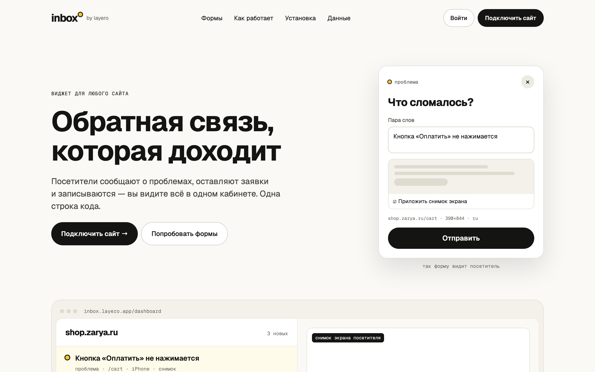
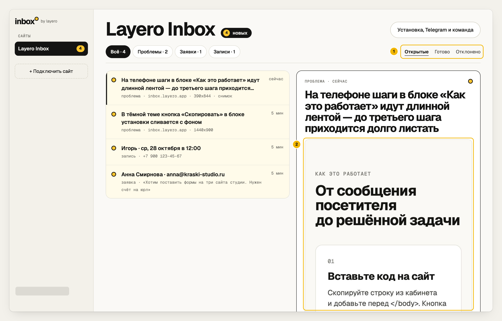

# Layero Inbox

**Обратная связь, заявки и онлайн-запись для любого сайта — без своего сервера.**
Эталонное приложение на [Layero](https://layero.ru): Postgres, Data API, вход
пользователей, файлы и уведомления в Telegram.

[Живое демо](https://inbox.layero.app) · [Статья: как это собрано](docs/article/ru.md) · [English](README.en.md)





## Что внутри

| | |
|---|---|
| **Виджет** `apps/widget` | Одна строка `<script>` на сайте клиента. Три формы: «Сообщить о проблеме» (со снимком экрана), «Оставить заявку», «Записаться» (свободные слоты по расписанию). |
| **Кабинет** `apps/web/dashboard` | Вход по почте или Яндекс ID, сайты, входящие с фильтрами и статусами, команда, настройки форм и расписания, Telegram одной кнопкой. |
| **Лендинг** `apps/web` | Страница продукта с живыми формами. |
| **База** `db/migrations` | Таблицы, RLS, функции Data API, политики хранилища, уведомления через `net.http_post`. |

Своего бэкенда нет: браузер ходит в [Data API](https://docs.layero.ru/data-api/)
(совместим с supabase-js), права решают политики RLS в Postgres, а всё, что
нельзя доверить браузеру, делают функции базы.

## Быстрый старт — 10 минут

Нужны: аккаунт Layero с общей базой (тариф Pro) или выделенной базой, Node 20+.

```bash
git clone https://github.com/LayeroInfra/layero-inbox && cd layero-inbox
npx layero@latest login

# необязательно — уведомления в Telegram (токен от @BotFather)
export TELEGRAM_BOT_TOKEN=…  TELEGRAM_BOT=my_inbox_bot

LAYERO_ORG=<организация> APP_ADDRESS=<адрес> ./scripts/setup.sh
```

Скрипт создаёт базу, включает Data API, вход и файлы, заводит бакет, применяет
схему и выкладывает два проекта: `<адрес>.layero.app` (лендинг и кабинет на
`/dashboard/`) и `<адрес>-widget.layero.app` (виджет). На нашем прогоне — 8 минут,
из них меньше минуты на базу ([лог](docs/img/setup-run.log)).

Дальше:

1. Зарегистрируйтесь в кабинете, добавьте сайт — кабинет покажет строку для вставки.
2. Вставьте её на свой сайт перед `</body>`.
3. В настройках сайта нажмите «Подключить Telegram» и «Старт» в боте.
4. Проверьте права: `./scripts/check-access.sh` (см. [database.md](docs/ru/database.md#проверка-прав)).

## Документация

- [Архитектура](docs/ru/architecture.md) — компоненты, почему виджет в iframe, что где выполняется
- [База данных и доступ](docs/ru/database.md) — схема, RLS, кто что может, снимки в приватном бакете
- [Виджет](docs/ru/widget.md) — встраивание, формы, контракт функций
- [Уведомления](docs/ru/notifications.md) — `net.http_post`, фото в Telegram, подключение одной кнопкой
- [Статья: собираем Layero Inbox шаг за шагом](docs/article/ru.md)

## Структура

```
apps/
  web/          лендинг (/) и кабинет (/dashboard/), Vite + supabase-js
  widget/       embed.js для чужих сайтов и форма в iframe
db/migrations/  0001 схема и RLS · 0002 формы · 0003 файлы · 0004 уведомления
scripts/
  setup.sh         вся инфраструктура одной командой
  check-access.sh  матрица прав через layero data probe
docs/
```

## Лицензия

MIT — берите за основу своих проектов.
