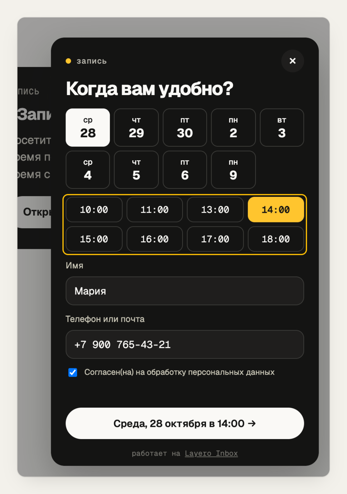

# Виджет

## Встраивание

Одна строка перед `</body>`:

```html
<script src="https://inbox-widget.layero.app/embed.js" data-site="st_…" async></script>
```

`st_…` — ключ сайта из кабинета. Он публичный: по нему можно только открыть
формы этого сайта и отправить их.

| Атрибут | Значение |
|---|---|
| `data-site` | ключ сайта, обязательно |
| `data-form` | какую форму открывает плавающая кнопка: `problem` (по умолчанию), `lead`, `booking` |
| `data-label` | текст плавающей кнопки |
| `data-position` | `right` (по умолчанию) или `left` |
| `data-button` | `off` — без плавающей кнопки |

Свои кнопки в любом месте страницы:

```html
<button data-inbox="lead">Оставить заявку</button>
<a href="#" data-inbox="booking">Записаться на звонок</a>
```

Скрипт защищён от двойного подключения (`window.__layeroInbox`) и включает
только те формы, что отмечены в настройках сайта.

## Три формы

| Форма | Поля | Что проверяет база |
|---|---|---|
| Проблема `problem` | текст, снимок экрана (по желанию) | текст не пустой |
| Заявка `lead` | имя, контакт, комментарий, согласие | контакт и согласие |
| Запись `booking` | день, слот, имя, контакт, согласие | слот свободен, контакт и согласие |



Слоты строятся по расписанию сайта (`booking_days`, `booking_from`, `booking_to`,
`booking_slot_minutes`) в его часовом поясе на 14 дней вперёд и не раньше чем
через 30 минут. Виджет показывает их в поясе сайта — посетитель из другого
города видит то же время, что и владелец.

## Поток отправки

```
embed.js (страница)          frame.html (iframe)                     Data API
 │ клик по кнопке
 │ снимок html2canvas-pro
 │── iframe ?site=…&form=… ─▶│
 │◀───────────── li:ready ───│
 │── контекст и снимок ─────▶│── rpc site_form ──────────────────────▶ формы, слоты
 │                           │── rpc submit_form ────────────────────▶ { id, upload_path }
 │                           │── POST storage/v1/object/screenshots/… ▶ файл
 │                           │── POST storage/v1/object/sign/… ──────▶ ссылка на 60 с
 │                           │── rpc notify_screenshot ──────────────▶ фото в Telegram
 │◀───────────── li:close ───│
```

Снимок делается до открытия iframe, и сам виджет на него не попадает: элементы
с атрибутами `data-layero-*` исключаются из снимка.

## Контракт функций

Вызов — `POST https://data.layero.ru/<база>/rest/v1/rpc/<имя>` с заголовком
`apikey: <публичный ключ>` и JSON-телом.

**`site_form(site_key)`** → `{ name, forms, timezone, slot_minutes, slots[] }`

**`submit_form(...)`** → `{ id, upload_path }`

| Аргумент | Тип | |
|---|---|---|
| `site_key` | text | обязательно |
| `form` | text | `problem`, `lead`, `booking` |
| `message` | text | до 2000 символов |
| `name`, `contact` | text | до 120 и 200 символов |
| `booking_at` | timestamptz | ISO-строка слота из `site_form` |
| `consent` | boolean | для заявки и записи |
| `page_url`, `user_agent`, `viewport`, `language` | text | контекст, обрезается |
| `has_screenshot` | boolean | вернуть путь для загрузки снимка |

Ошибки приходят с кодом Postgres в поле `code`: `22023` — неверные данные или
занятый слот, `54000` — больше 30 сообщений в минуту на сайт.

**`notify_screenshot(report_id, signed_url)`** → `true`, если уведомление ушло
или не требовалось.

## Свои формы без виджета

Функции — обычный HTTP, их можно звать из своей формы. Но только с адреса,
который разрешён в CORS Data API (`layero data origins`): по умолчанию это
адреса ваших проектов на Layero. Поэтому для чужих сайтов и нужен iframe.
